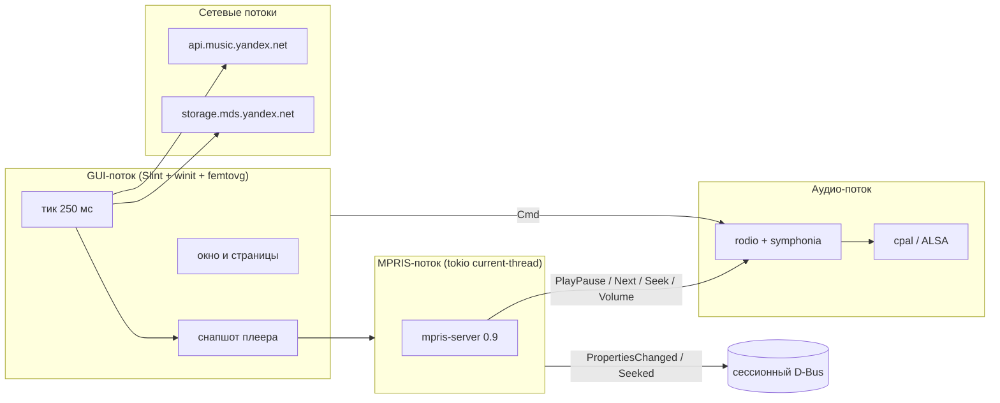

# Яндекс Музыка RS под Linux

Отдельный документ к [README.md](README.md): что работает под Linux, где приложение хранит
данные, как собрать deb и что смотреть, если что-то пошло не так.

Целевая система: Ubuntu 26.04, Wayland (GNOME), OpenGL 4.6 (проверено на Intel Iris Xe, Mesa 26).
X11/XWayland тоже работает, но есть нюансы — см. [«Wayland и масштаб»](#wayland-и-масштаб).

## Что есть и чего нет

| Возможность | Linux | Примечание |
|---|---|---|
| Нативное окно, всё воспроизведение | ✅ | рендерер `femtovg` (OpenGL), Skia в Linux-сборку не входит |
| Управление из системы | ✅ | MPRIS 2: виджет медиа в GNOME Shell, системные медиа-клавиши |
| Автозапуск | ✅ | `~/.config/autostart/yamusic-rs.desktop`, запуск с `--hidden` |
| Один экземпляр | ✅ | Unix-сокет в `$XDG_RUNTIME_DIR`; повторный запуск показывает окно |
| Обложки, тексты, эквалайзер, скачивание | ✅ | как в Windows-версии |
| Трей | ❌ | вместо него — MPRIS; при закрытии окна во время игры процесс живёт |
| Обновление из приложения | ❌ | только уведомление; кнопка открывает страницу релиза |
| Статус в Discord | ❌ | включён по умолчанию только в Windows-сборке |
| Шифрование токена | ⚠️ | DPAPI нет: токен в `config.json` в base64 без шифрования, файл `0600` |

## Установка

```bash
# зависимости и установка одним шагом
sudo apt install ./yamusic-rs_1.0.0-1_amd64.deb

# проверить, что пакет видит систему
dpkg -s yamusic-rs | grep -E 'Version|Depends'

# удалить (конфиг и токен останутся)
sudo apt remove yamusic-rs
rm -rf ~/.config/yamusic-rs          # если нужно убрать и данные
```

Зависимости пакета и зачем они:

| Пакет | Зачем |
|---|---|
| `libasound2` | звук (rodio → cpal → ALSA) |
| `libegl1`, `libgl1` | контекст OpenGL для femtovg |
| `libwayland-client0`, `libwayland-egl1` | окно и поверхность EGL под Wayland |
| `libxkbcommon0` | раскладка и ввод (winit) |
| `libfontconfig1`, `libfreetype6` | поиск и растеризация шрифтов |
| `xdg-utils` | открытие ссылок (`xdg-open`) |
| `wl-clipboard` | копирование кода входа и ссылок (`wl-copy`) |
| `xclip` (Recommends) | то же под X11, если `wl-copy` недоступен |
| `xdg-user-dirs` (Recommends) | настоящий каталог музыки для скачивания (`xdg-user-dir MUSIC`) |

## Запуск

```bash
yamusic-rs              # обычный запуск
yamusic-rs --hidden     # без окна: только MPRIS и медиа-клавиши (так стартует автозапуск)
yamusic-rs --tray       # алиас --hidden (совместимость с Windows-версией)
```

Поведение окна:

- **Закрыть (✕) во время воспроизведения** — окно скрывается, музыка играет дальше.
- **Закрыть, когда ничего не играет** — процесс завершается.
- **Повторный запуск `yamusic-rs`** — окно уже работающего экземпляра показывается, второй процесс
  сразу выходит (никаких двух плееров и двух записей MPRIS).

## Управление через MPRIS

Приложение занимает имя `org.mpris.MediaPlayer2.yamusic_rs` на сессионной шине D-Bus.

| Что | Как |
|---|---|
| Виджет медиа | GNOME Shell → быстрые настройки → блок «Яндекс Музыка RS» |
| Медиа-клавиши | Play/Pause, Next, Previous работают на активный плеер |
| Методы | `PlayPause`, `Play`, `Pause`, `Next`, `Previous`, `Seek`, `SetPosition` |
| Свойства | `PlaybackStatus`, `Metadata` (название, исполнитель, альбом, длина, `artUrl`), `Volume`, `LoopStatus`, `Shuffle`, `Position` |
| `Raise` / `Quit` | показать окно / завершить приложение |

Проверка из терминала:

```bash
busctl --user list | grep yamusic
busctl --user get-property org.mpris.MediaPlayer2.yamusic_rs \
  /org/mpris/MediaPlayer2 org.mpris.MediaPlayer2.Identity
busctl --user get-property org.mpris.MediaPlayer2.yamusic_rs \
  /org/mpris/MediaPlayer2 org.mpris.MediaPlayer2.Player PlaybackStatus
busctl --user call org.mpris.MediaPlayer2.yamusic_rs \
  /org/mpris/MediaPlayer2 org.mpris.MediaPlayer2.Player PlayPause
```

Как это устроено:

- сервер живёт в отдельном потоке (`mpris-server 0.9` + `tokio` current-thread + `LocalSet`);
- тик GUI раз в 250 мс отправляет снапшот (трек, позиция, громкость, режимы), сервер меняет только
  изменившиеся свойства;
- `Position` по спецификации MPRIS не рассылается в `PropertiesChanged`: на перемотке и смене трека
  приходит сигнал `Seeked`, по нему GNOME перечитывает позицию (это и есть полоса прогресса в виджете);
- `artUrl` — локальный файл `~/.config/yamusic-rs/mpris-cover` (GNOME читает только `file://`);
- нет D-Bus или он запрещён — приложение просто работает без виджета, ошибка уходит в лог.

## Где хранятся данные

Каталог: `$XDG_CONFIG_HOME/yamusic-rs` (обычно `~/.config/yamusic-rs`).

| Путь | Что |
|---|---|
| `config.json` | настройки и токен (`0600`) |
| `log.txt` | лог; при размере больше 512 КБ удаляется и начинается заново |
| `device` | идентификатор устройства для входа по коду |
| `assets/fonts/*.woff`, `assets/icons/*.svg` | кэш шрифтов и иконок веб-версии |
| `mpris-cover` | обложка текущего трека для `artUrl` |
| `$XDG_RUNTIME_DIR/yamusic-rs.sock` | сокет единственного экземпляра (без `XDG_RUNTIME_DIR` — в каталоге данных) |
| `~/.config/autostart/yamusic-rs.desktop` | только при включённом автозапуске |

Автозапуск включается в настройках приложения. Файл содержит:

```ini
[Desktop Entry]
Type=Application
Name=Яндекс Музыка RS
Exec=/usr/bin/yamusic-rs --hidden
Terminal=false
X-GNOME-Autostart-enabled=true
```

При каждом запуске приложение перезаписывает этот файл, если автозапуск включён: путь к бинарю
обновляется после переустановки пакета.

## Как это устроено



Ключевые отличия от Windows-сборки:

| Место | Windows | Linux |
|---|---|---|
| Рендерер | `skia-software` | `femtovg` (OpenGL); `skia-safe` остался зависимостью только Windows |
| Платформенный слой | `win.rs::win32` (Win32 API) | `win.rs::linux` (XDG, `gsettings`, `rfd`, `xdg-open`) |
| Единственный экземпляр | мьютекс `Local\yamusic_rs_single_instance` + файл `hwnd` | Unix-сокет + протокол `wake` |
| Токен | DPAPI + base64 в `config.json` | base64 с маркером `RAW` + права `0600` |
| Трей | значок в области уведомлений | нет, MPRIS |
| Обновление | скачивание exe, сверка SHA-256, подмена файла | только уведомление и ссылка на релиз |
| Discord | именованный канал Windows | поток не запускается, переключатель показывает тост |
| Идентификатор окна | `StartupWMClass` | `slint::set_xdg_app_id("yamusic-rs")` — совпадает с `.desktop` |
| Копирование | `clip.exe` | `wl-copy`, затем `xclip` |
| Шрифты и иконки | из `app.asar` установленного приложения | из кэша `assets/`, при первом запуске скачиваются с `music.yandex.ru` |

Особенности, которые стоит знать:

- **Шрифты.** Шрифты YS Text / YS Music Headline не входят в репозиторий и пакет. При первом запуске
  приложение скачивает `fonts/*.woff` и `icons/sprite.svg` с `music.yandex.ru` в
  `~/.config/yamusic-rs/assets` и держит их в кэше. Нет сети при первом запуске — интерфейс
  отрисуется системным шрифтом, картинки появятся после успешной загрузки.
- **Тема.** «Системная» читается из GNOME (`gsettings get org.gnome.desktop.interface color-scheme`);
  если GNOME нет — тёмная.
- **Имя устройства.** В списке устройств аккаунта Яндекс приложение показывается как
  «Яндекс Музыка RS (<hostname>)»: `hostname` берётся из `$HOSTNAME` / `/etc/hostname`.
- **Скачивание треков** идёт в «<каталог музыки>/Яндекс Музыка»: путь берётся у `xdg-user-dir MUSIC`
  (обычно `~/Музыка`), без `xdg-user-dirs` — `~/Music`.
- **Диалог выбора обложки** — через `xdg-desktop-portal` (`rfd`), в контейнере без портала не откроется.

## Wayland и масштаб

- Масштаб окна задаёт композитор: база берётся из `winit` (`Window::scale_factor`), дробный масштаб
  125/150 % учитывается целиком.
- Интерфейс дополнительно «подрастает» на широких окнах: при ширине ≥ 1920 CSS-пикселей
  множитель `k = (12 + 0.003 × ширина) / 16`. Значение пишется в лог строкой `масштаб: …`.
- На Linux **не отправляются** синтетические `ScaleFactorChanged`/`Resized`: под Wayland они
  рассинхронизируют состояние Slint и winit (симптом — окно рисуется, но клики и обновления UI
  «зависают»). Масштаб применяется только свойствами `ui-scale`/`dpr`.
- Форсировать базу можно переменной окружения:

  ```bash
  SLINT_SCALE_FACTOR=1.5 yamusic-rs
  ```

- Заголовок окна свой (`no-frame: true`), кнопки свернуть/развернуть/закрыть — часть интерфейса.
  Перетаскивание и изменение размера через рамку — возможности winit, которых под Wayland нет:
  двигайте и растягивайте окно средствами композитора (`Super` + перетаскивание).
- Принудительно X11 (например, для отладки): `WINIT_UNIX_BACKEND=x11 yamusic-rs`.

## Сборка

Собирать нужно контейнером: на хосте не требуется Rust, а образ фиксирует версию тулчейна
(`rust:1.92-bookworm`, требование `Cargo.toml`).

```bash
# 1. образ с зависимостями slint/winit/rodio и cargo-deb
podman build -t localhost/yamusic-build -f tools/Containerfile.build .

# 2. проверки и сборка пакета
podman run --rm -v "$PWD":/src:Z \
  -v yamusic-cargo:/usr/local/cargo/registry \
  -v yamusic-target:/src/target \
  -w /src localhost/yamusic-build \
  cargo clippy --all-targets -- -D warnings

podman run --rm -v "$PWD":/src:Z \
  -v yamusic-cargo:/usr/local/cargo/registry \
  -v yamusic-target:/src/target \
  -w /src localhost/yamusic-build \
  cargo test

podman run --rm -v "$PWD":/src:Z \
  -v yamusic-cargo:/usr/local/cargo/registry \
  -v yamusic-target:/src/target \
  -w /src localhost/yamusic-build \
  cargo deb
# → target/debian/yamusic-rs_1.0.0-1_amd64.deb
```

В образе: `pkg-config`, `libasound2-dev`, `libfontconfig1-dev`, `libfreetype6-dev`,
`libxkbcommon-dev`, `libxkbcommon-x11-dev`, `libwayland-dev`, `libx11-dev`, `libx11-xcb-dev`,
`clippy`, `cargo-deb`. Версия пакета берётся из `Cargo.toml`, состав и зависимости — из
`[package.metadata.deb]`.

Проверка установки на чистой системе (без установки чего-либо на хост):

```bash
podman run --rm -v "$PWD":/src:Z ubuntu:26.04 sh -c '
  apt-get update -qq &&
  apt-get install -y --no-install-recommends /src/yamusic-rs_1.0.0-1_amd64.deb &&
  dpkg -s yamusic-rs | grep Depends'
```

Smoke-тест с живым GPU и сессией Wayland (окно появится на экране пользователя):

```bash
podman run --rm --userns=keep-id --device /dev/dri \
  -e WAYLAND_DISPLAY=wayland-0 -e XDG_RUNTIME_DIR=/run/xdg -e HOME=/tmp/home \
  -v /run/user/1000:/run/xdg:Z \
  yamusic-build:latest /usr/bin/yamusic-rs

# в другом терминале
busctl --user get-property org.mpris.MediaPlayer2.yamusic_rs \
  /org/mpris/MediaPlayer2 org.mpris.MediaPlayer2.Player PlaybackStatus
```

CI: `.github/workflows/build.yml`, Linux-джоба — `clippy`, `cargo test`, `cargo deb`, выгрузка
артефакта.

## Диагностика

Всё пишется в `~/.config/yamusic-rs/log.txt` (в debug-сборке ещё и в stderr). Что искать:

| Строка в логе | О чём говорит |
|---|---|
| `масштаб: окно … физ., база …, k …` | как winit определил масштаб и что применил интерфейс |
| `клик: «Открыть ya.ru/device»` / `клик: «Скопировать код» (…)` | клик дошёл до обработчика |
| `буфер обмена: wl-copy не найден` | не установлен `wl-clipboard` (или нет `xclip` под X11) |
| `xdg-open …: код N` | браузер не открылся, `xdg-open` вернул ошибку |
| `mpris: …` | не удалось занять имя в D-Bus |
| `не занять сокет единственного экземпляра: …` | проблема с `$XDG_RUNTIME_DIR`, второй экземпляр не проснётся |
| `обновления: …` | ошибка проверки релизов GitHub |
| `ассет fonts/…: HTTP …` | не скачались шрифты/иконки веб-версии |
| `токен не расшифровался …` | конфиг от Windows-версии с DPAPI, нужен новый вход |

Быстрые проверки:

```bash
pgrep -a yamusic-rs                    # процесс жив?
ls -l ~/.config/yamusic-rs/            # конфиг и лог на месте?

# попросить работающий экземпляр показать окно (как повторный запуск)
python3 - <<'EOF'
import os, socket
s = socket.socket(socket.AF_UNIX)
s.connect(os.path.join(os.environ["XDG_RUNTIME_DIR"], "yamusic-rs.sock"))
s.sendall(b"wake")
print("запрос отправлен")
EOF
```

Если окно рисуется, но не реагирует на мышь, или не обновляется состояние воспроизведения —
приложите к отчёту `log.txt` целиком и укажите сессию (`echo $XDG_SESSION_TYPE`), разрешение и
масштаб, версию Mesa (`glxinfo -B` или `eglinfo`).

## Известные ограничения

- Трея нет: свернуть «в фон» можно только закрытием окна во время игры или запуском `--hidden`.
- Self-update нет: новая версия ставится через `apt`; уведомление ведёт на страницу релиза.
- Позиция в виджете GNOME обновляется по `Seeked` и смене трека; во время обычного воспроизведения
  GNOME сам считает время от последнего известного значения.
- Рамка окна не тянется под Wayland (см. выше).
- Discord Rich Presence не реализован для Linux-IPC.
- Пакет собран под glibc ≥ 2.38 и архитектуру `amd64`; arm64 и musl не проверялись.

## Безопасность

- Токен уходит только на `yandex.ru`/`yandex.net` по https — единая точка проверки
  `client.rs::token_allowed` (с тестами на подмену домена).
- Под Linux токен лежит в `config.json` в base64 (маркер `RAW`), файл создаётся с правами `0600`.
  Шифрования уровня DPAPI нет: любой процесс вашего пользователя может его прочитать.
- Приложение запускает только: `xdg-open` (ссылки), `wl-copy`/`xclip` (буфер обмена),
  `gsettings` (тема). Больше ничего не исполняет.
- Полный план аудита и инвентаризация исходящих хостов — `openspec/changes/linux-port/security-audit.md`,
  модель угроз — [SECURITY.md](SECURITY.md).
